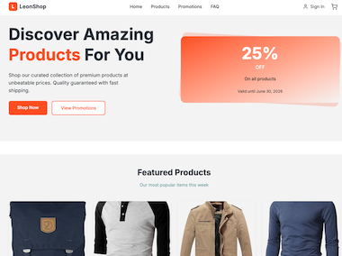
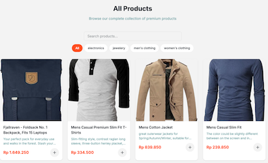
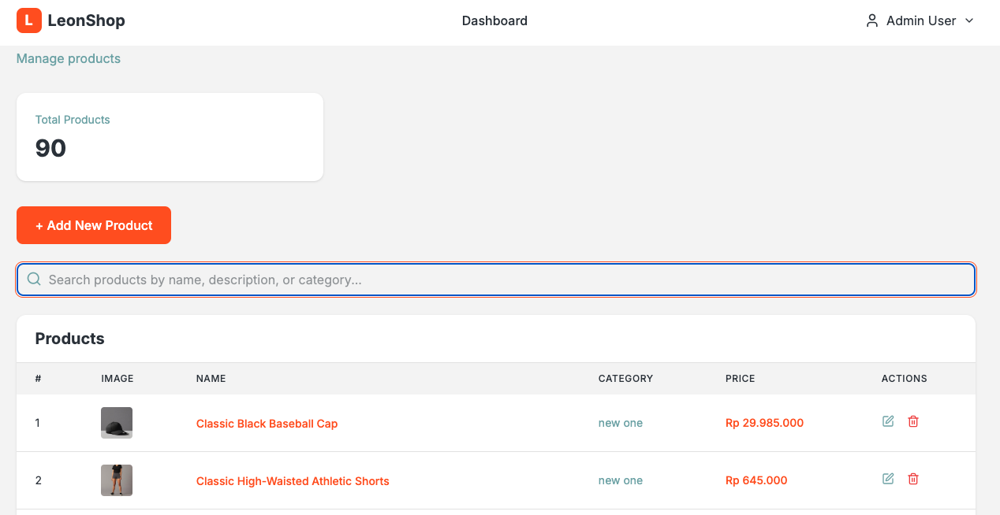
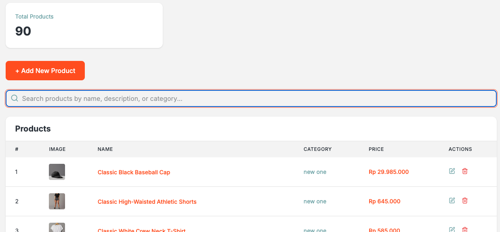
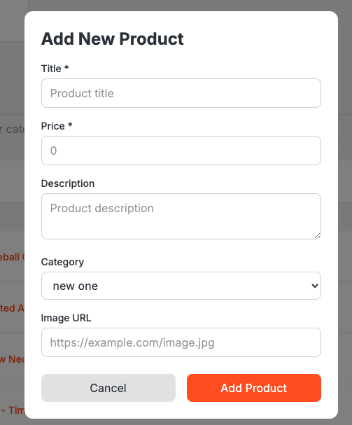

# LeonShop - Online Store

A modern e-commerce platform built with Next.js 16 App Router, featuring product browsing, cart management, user authentication, and admin dashboard.

## Overview

LeonShop is a fully functional online store application built with following Next.js. The application provides a seamless shopping experience for customers with product browsing, detailed product pages, cart management, and an admin dashboard for product management.

## Features

### For Customers

- **Product Browsing**: Browse products in a responsive grid layout with search and filter
- **Product Details**: View detailed product information including images, descriptions, and pricing (IDR)
- **Cart Management**: Add products to cart with quantity selection (uses localStorage)
- **Promotions Page**: View current promotions and discounts
- **FAQ Section**: Find answers to common questions
- **User Authentication**: Sign in with customer account (admin or customer)
- **Checkout Process**: Complete purchase with shipping and payment information (with validation)
- **Contact Page**: Send messages to customer service (with validation)
- **Featured Products**: See top 4 featured products on home page

### For Administrators

- **Admin Dashboard**: Manage products with search, pagination, and statistics
- **Product Management**: Add, edit, and delete products via Escuela JS API
- **Search Functionality**: Search products by name, description, or category
- **Pagination**: View 10 products per page

## Tech Stack

- **Framework**: Next.js 16 (App Router with src folder)
- **Language**: JavaScript (ES6+), and Typescript
- **Styling**: Tailwind CSS
- **Icons**: Lucide React
- **APIs**:
  - Platzi Fake Store API (customer-facing products)
  - Escuela JS API (admin product CRUD operations)

## Project Structure

```
leon-shop/
├── src/
│   ├── app/               # Next.js App Router pages
│   │   ├── admin/         # Admin dashboard
│   │   ├── cart/          # Shopping cart page
│   │   ├── checkout/      # Checkout page
│   │   ├── contact/       # Contact page
│   │   ├── faq/           # FAQ page
│   │   ├── login/         # User authentication page
│   │   ├── order-success/ # Order confirmation page
│   │   ├── products/      # Product pages
│   │   │   └── [id]/      # Dynamic product detail route
│   │   ├── promotions/    # Promotions page
│   │   ├── layout.jsx     # Root layout with header/footer
│   │   ├── page.jsx       # Home page
│   │   └── globals.css    # Global styles
│   ├── components/        # React components
│   │   ├── home/          # Home page components
│   │   ├── layout/        # Layout components (Header, Footer)
│   │   └── product/       # Product-related components
│   ├── lib/               # Utility functions
│   │   ├── api.js         # API integration (Platzi & Escuela JS)
│   │   ├── auth.js        # Authentication logic
│   │   ├── cart.js        # Cart management
│   │   └── data.js        # User mock data with localStorage
│   └── public/            # Static assets
├── screenshots/           # Application screenshots
├── next.config.ts         # Next.js configuration
├── tsconfig.json          # TypeScript configuration
├── package.json           # Dependencies and scripts
└── README.md              # App documentation
```

## Getting Started

### Prerequisites

- Node.js 18+
- npm or yarn or bun

### Installation

1. Clone the repository

2. Install dependencies:

```bash
npm install
```

or

```bash
bun install
```

3. Run the development server:

```bash
npm run dev
```

or

```bash
bun dev
```

4. Open [http://localhost:3000](http://localhost:3000) in your browser

### Build for Production

```bash
npm run build
npm start
```

or

```bash
bun run build
bun start
```

## Color Palette

The application uses a specific pastel color scheme:

- **Primary**: `#FF5722` (Orange)
- **Secondary**: `#303841` (Dark Gray)
- **Accent**: `#76ABAE` (Teal)
- **Light**: `#F5F5F5` (Light Gray)

## Currency

All prices are displayed in **Indonesian Rupiah (IDR)** using proper formatting with thousand separators (dots).

## API Integration

### Customer-Facing Pages

Uses **Platzi Fake Store API** for product data:

- Products: `https://fakestoreapi.com/products`
- Categories: `https://fakestoreapi.com/products/categories`
- Product by ID: `https://fakestoreapi.com/products/{id}`
- Related products: `https://fakestoreapi.com/products/{id}/related`

### Admin Dashboard

Uses **Escuela JS API** for CRUD operations:

- GET products: `https://api.escuelajs.co/api/v1/products?offset=0&limit=10`
- POST product: `https://api.escuelajs.co/api/v1/products`
- PUT product: `https://api.escuelajs.co/api/v1/products/{id}`
- DELETE product: `https://api.escuelajs.co/api/v1/products/{id}`
- GET categories: `https://api.escuelajs.co/api/v1/categories`

All prices from external APIs are converted from USD to IDR (1 USD = 15,000 IDR).

## Authentication

The application includes a mock authentication system:

- **Admin Login**: Specific user admin is set to do Product management
- **Customer Login**: Any email/password creates can do login as customer account
- Redirects to previous page after login (cart/checkout)

## Screenshots

### Home Page with Featured Products



### Product Listing Page



### Admin Dashboard



### Admin Product Management



### Admin Add Product Modal



## Validation

### Checkout Page

- All fields are required and validated on blur
- Email format validation
- Card number (16 digits) validation
- Expiry date (MM/YY format) validation
- CVC (3 digits) validation

### Contact Page

- Name, email, subject, and message are required
- Email format validation
- Errors displayed below input fields

## Features Implementation

✅ Home Page with Hero Section and Featured Products
✅ Product Listing Grid with Search and Filter
✅ Product Detail Page with Dynamic Routing
✅ Cart Management (Local Storage)
✅ Promotions Page
✅ FAQ Section
✅ Responsive Design
✅ User Authentication (Customer & Admin)
✅ Admin Dashboard with Search and Pagination
✅ Product Management (Admin) via Escuela JS API
✅ Shopping Cart
✅ Checkout Process with Validation
✅ Contact Page with Validation
✅ Order Success Page
✅ Lucide Icons Integration
✅ Next.js Image Optimization
✅ Src folder structure
✅ Next.js 16 App Router

## Author

The LeonShop web development team.
